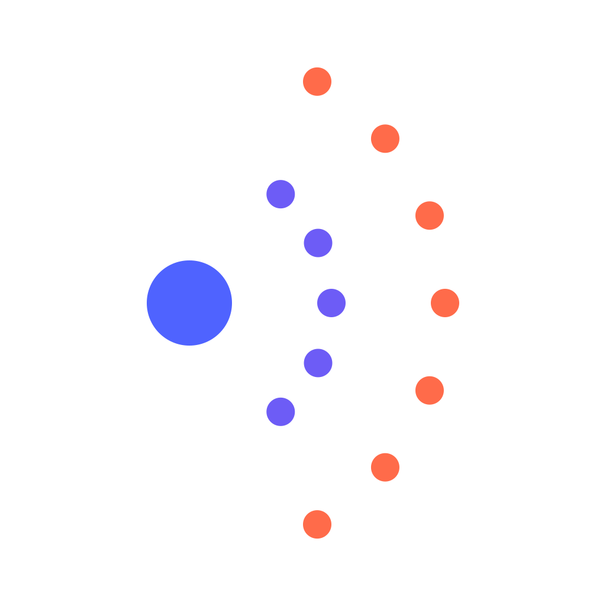

<p align="center">
  
</p>

<h1 align="center">Urmare</h1>

<p align="center">
  Fast, deterministic impact analysis for Python repositories.
</p>

It answers one question:

> Given a Python code change, what follows from it?

Urmare maps static imports, supported re-exports, literal dynamic imports, and
pytest fixture/configuration relationships. It calculates affected modules and
pytest files and explains dependency paths. Analysis runs locally without a
hosted service or a Python runtime.

The project is an early MVP. It intentionally focuses on file-level static
imports and favors impact recall over aggressive test reduction.

## What Urmare does

- finds direct and transitive dependents of one or more changed Python files;
- selects affected pytest files, including applicable `conftest.py` and
  statically recognizable fixture relationships;
- produces structured validation plans for coding agents and CI;
- analyzes staged, unstaged, untracked, committed, deleted, and renamed Git
  changes;
- explains each result with a deterministic dependency path and import
  locations;
- supports flat, `src/`, and explicitly configured multi-root repositories;
- maintains a persistent local index with bounded updates for Git repositories;
- emits stable, versioned JSON for scripts, CI, and coding agents; and
- exposes validation planning and dependency explanations to agents through a
  local, read-only MCP server.

## Install

Install Urmare as an isolated tool with [uv](https://docs.astral.sh/uv/) or
[pipx](https://pipx.pypa.io/):

```bash
uv tool install urmare
# or
pipx install urmare
```

You can also install it in a virtual environment:

```bash
python -m venv .venv
source .venv/bin/activate
pip install urmare
```

On Windows, activate with `.venv\Scripts\activate`.

PyPI wheels contain the standalone Rust CLI and do not compile code during
installation. Prebuilt binaries support macOS ARM64 and x86-64, Linux glibc
ARM64 and x86-64 with a `manylinux_2_17` baseline, and Windows MSVC x86-64.
Standalone archives for the same targets are available from GitHub Releases.

## Quick start

Run Urmare from the repository you want to analyze:

```bash
# What should an agent validate after editing the working tree?
urmare plan --changed --json

# What depends on this file?
urmare impact src/payments/stripe.py

# Which tests are affected?
urmare tests --affected src/payments/stripe.py

# Why is this test affected?
urmare why src/payments/stripe.py tests/api/test_checkout.py
```

Analyze more than one explicit change at once:

```bash
urmare impact src/payments/models.py src/payments/stripe.py
urmare plan src/payments/models.py src/payments/stripe.py --json
```

Analyze the current Git working tree or all branch changes since a merge base:

```bash
urmare impact --changed
urmare tests --affected --changed
urmare plan --changed --json

urmare impact --git-diff origin/main
urmare tests --affected --git-diff origin/main
urmare plan --git-diff origin/main --json
```

Inspect the repository graph when a mapping or result is surprising:

```bash
urmare graph
urmare graph --debug --focus src/payments/service.py
```

Common options:

- `--json` returns complete, deterministic machine-readable output.
- `--all` disables truncation in supported human-readable output.
- `--root PATH` analyzes another repository instead of the current directory.
- `urmare help COMMAND` shows the complete grammar for a command.

Explicit files, `--changed`, and `--git-diff` are alternative change sources
and cannot be combined. Invalid or unindexed paths fail with an actionable
diagnostic instead of returning a partial result.

## Agent validation workflow

`plan` is the recommended agent-facing entry point. It returns affected code,
selected pytest files, attribution, and structured validation steps in one
deterministic result:

```text
agent edits Python code
    ↓
urmare plan --changed --json
    ↓
agent runs every validation step
    ↓
agent uses urmare why when an impact path needs investigation
    ↓
CI independently recomputes the plan
```

Copy this instruction into a terminal-capable coding agent:

```text
After modifying Python code:

1. Run `urmare plan --changed --json`.
2. Execute every validation step using the repository’s established environment.
3. If the plan requires full validation, run the complete test suite.
4. Do not claim completion until the required validation succeeds.
5. Use `urmare why` when an affected relationship needs explanation.
```

For example, after an agent edits `src/payments/service.py`, Urmare may return:

```json
{
  "schema_version": 1,
  "changed": ["src/payments/service.py"],
  "directly_affected": ["src/api/checkout.py"],
  "transitively_affected": ["tests/api/test_checkout.py"],
  "affected_tests": ["tests/api/test_checkout.py"],
  "validation": {
    "mode": "selective",
    "steps": [{
      "kind": "pytest",
      "program": "pytest",
      "args": ["tests/api/test_checkout.py"]
    }]
  },
  "attributions": [{
    "affected": "tests/api/test_checkout.py",
    "caused_by": ["src/payments/service.py"]
  }]
}
```

If that repository uses uv, the agent then runs its established environment
with the supplied target:

```bash
uv run pytest tests/api/test_checkout.py
```

Urmare plans validation but does not execute pytest. Agents and CI remain
responsible for invoking the repository's established test environment.

The [GitHub Actions guide](docs/ci.md) covers independent PR planning, safe
`uv run pytest` consumption, and plan artifacts. The planning Action is intended
for v0.5.0; that release is not yet available.

## Local MCP server

MCP support requires Urmare 0.4.0 or newer.

MCP-capable coding agents can call the same validation-plan and explanation
operations directly, without constructing Urmare shell commands. Install
Urmare persistently, then bind one stdio server process to one absolute
repository root:

```bash
uv tool install urmare
# or: pipx install urmare

urmare --root /absolute/path/to/repository mcp
```

The server exposes exactly two read-only tools:

- `validation_plan` returns the same schema-version-1 object as
  `urmare plan ... --json`;
- `explain_impact` returns the same object as `urmare why ... --json`.

Every call refreshes the persistent index, so a long-running server observes
later edits while retaining clean and incremental reuse. Protocol traffic is
the only stdout output. Urmare never runs pytest or writes inside the analyzed
repository, although it may update its private operating-system cache.

See the [MCP setup guide](docs/mcp.md) for Codex, Claude Code, and Cursor
configuration, tool schemas, the root security boundary, and troubleshooting.

## Configuration

Flat and conventional `src/` layouts work without configuration. For monorepos
or custom layouts, add `[tool.urmare]` to the repository's `pyproject.toml`:

```toml
[tool.urmare]
source-roots = ["packages/payments/src", "packages/api/src"]
test-roots = ["verification", "integration/checks"]
exclude = ["generated/**", "vendor", "**/snapshots/*.py"]
```

- Source roots define module identities.
- Test roots supplement `test_*.py` and `*_test.py` discovery.
- Exclusions are repository-relative `/`-separated globs.
- Result paths always remain canonical and repository-relative.

Configuration is validated strictly. Missing roots, escaping paths, invalid
globs, unknown options, and ambiguous modules are rejected. A Git change to the
root `pyproject.toml` requires full validation and conservatively selects every
eligible test rather than claiming a selective result.

## Incremental indexing

Urmare stores a versioned index in the operating system's per-user cache,
isolated by canonical repository root. It never writes cache data into the
analyzed repository and requires no daemon or remote service.

For a Git repository at its top level, Urmare uses Git changes and content
hashes to update only relevant files and relationships. A clean reuse performs
no Python parsing, import resolution, graph mutation, or index writes. A
content-only one-file edit parses that file without re-resolving unchanged
imports.

Unsafe or incompatible states fall back to a complete correct analysis. These
include non-Git roots, configuration or source-root changes, corrupt indexes,
tracked submodules, nested untracked repositories, and Git index flags that can
hide content changes.

## JSON and exit codes

Every analysis command accepts `--json`. JSON is written to stdout, uses
canonical repository-relative paths, and includes a `schema_version`. MCP
returns the shared plan and explanation DTOs as `structuredContent`. CLI
failures leave stdout empty and write an actionable diagnostic to stderr.

An impact result has this concise shape:

```json
{
  "schema_version": 1,
  "changed": ["src/payments/stripe.py"],
  "directly_affected": ["src/payments/service.py"],
  "transitively_affected": ["src/api/checkout.py"],
  "affected_tests": ["tests/api/test_checkout.py"],
  "attributions": [
    {
      "affected": "tests/api/test_checkout.py",
      "caused_by": ["src/payments/stripe.py"]
    }
  ]
}
```

`plan --json` has its own schema version 1. Its `validation.mode` is
`selective`, `none`, or `full`; steps contain a program and argument array, not
a shell command. In `full` mode the pytest step has no file arguments and the
existing `full_validation` object explains why complete discovery is required.

| Code | Meaning |
|---:|---|
| `0` | Analysis completed successfully, including an empty result. |
| `1` | Unexpected internal, serialization, or output failure. |
| `2` | Invalid CLI arguments or configuration. |
| `3` | Repository, Git state, source, or dependency path could not be analyzed. |

## Performance

A real-project reference run on 2026-09-03 used 15 independent paired samples
per project on an Apple M5 Pro with 18 logical cores and 48 GiB of memory. These
are median end-to-end CLI latencies for Urmare commit
`daaf7a592bb54ef0ee71b1ed3065caaf9187d67b`:

| Project | Cold | Warm | One-file incremental |
|---|---:|---:|---:|
| Flask | 115.883 ms | 75.254 ms | 78.609 ms |
| FastAPI | 221.809 ms | 91.923 ms | 100.880 ms |
| Django | 628.448 ms | 220.379 ms | 230.289 ms |
| pandas | 456.446 ms | 117.072 ms | 125.998 ms |
| Apache Airflow | 610.023 ms | 255.853 ms | 262.839 ms |

All cold, warm, and incremental results matched fresh uncached analysis. Each
content-only incremental run parsed and hashed one file, re-resolved no
importers, changed no graph edges, and wrote two index records.

These are machine-specific observations, not portable guarantees. See the
[performance methodology and complete distributions](docs/performance.md#real-project-reference-observation),
including corpus revisions, binary provenance, work counters, raw-data digest,
limitations, and the separate synthetic scaling results.

<details>
<summary>Reproduce the real-project benchmark</summary>

Build the CLI and profiling helper from the same clean commit:

```bash
cargo build --release --locked -p urmare-cli --bin urmare
cargo build --release --locked -p urmare-core --example profile_repository
```

Prepare, inspect, run 15 samples, and summarize the preserved raw JSON Lines:

```bash
python3 benchmarks/real_projects/benchmark.py prepare \
  --work-dir target/real-project-benchmark
python3 benchmarks/real_projects/benchmark.py dry-run \
  --work-dir target/real-project-benchmark \
  --binary target/release/urmare \
  --profile-helper target/release/examples/profile_repository
python3 benchmarks/real_projects/benchmark.py run \
  --work-dir target/real-project-benchmark \
  --binary target/release/urmare \
  --profile-helper target/release/examples/profile_repository \
  --samples 15 \
  --output target/real-project-benchmark/raw/official.jsonl
python3 benchmarks/real_projects/benchmark.py summarize \
  --input target/real-project-benchmark/raw/official.jsonl \
  --output target/real-project-benchmark/summary/official.md
```

Only `prepare` requires network access. Use `benchmark.py smoke` for the same
lifecycle against a small offline fixture. The performance document contains
the complete command and safety details.

</details>

Run the separate deterministic synthetic suite with:

```bash
cargo bench -p urmare-core --bench synthetic --locked
```

Set `URMARE_BENCH_50000=1` to include the 50,000-file case.

## Current limitations

- static imports, supported package re-exports, and literal calls to
  `importlib.import_module` and `__import__`;
- pytest configuration, literal fixture requests (including literal
  `request.getfixturevalue`), fixture dependencies,
  autouse fixtures, `usefixtures` marks, and repository-local `pytest_plugins`;
- conservative full validation when dynamic fixture lookup, computed exports,
  or computed dynamic-import targets affect the requested change;
- unsupported decorators, external plugins, computed `__all__`, and dynamic
  fixture lookup are reported as uncertain rather than treated as resolved;
- no symbol-, call-, type-, or framework-level graph;
- test selection is file-level, not individual test functions;
- unresolved imports mean no repository-local module matched; installed
  environments and package indexes are not inspected;
- non-Git repositories conservatively rebuild on every invocation;
- broad impact and complete graph/debug output remain proportional to their
  result size;
- no test execution, CI execution, remote/hosted MCP transport, authentication,
  or hosted integration.

When Python semantics are ambiguous, Urmare conservatively includes certain
local package and module loads. False positives are preferable to silently
missing affected code or tests.

## Development

Build from source with Rust 1.95 or newer:

```bash
git clone https://github.com/sorginte/urmare.git
cd urmare
cargo build --release
```

Run the required checks before submitting a change:

```bash
cargo fmt --all -- --check
cargo clippy --workspace --all-targets --locked -- -D warnings
cargo test --workspace --locked
cargo +1.95.0 check --workspace --all-targets --locked
```

The workspace separates the generic graph, Python analysis, domain core,
shared application operations, machine-readable contracts, CLI, and MCP
adapter into focused crates. Purpose-built fixture repositories live under
`fixtures/python-projects/`.

Further reading:

- [Product specification and design principles](docs/product_spec.md)
- [Roadmap and upcoming milestones](docs/roadmap.md)
- [Local MCP setup and security](docs/mcp.md)
- [Performance methodology and observations](docs/performance.md)
- [Release process](docs/releasing.md)

## License

Urmare is available under the MIT License.
